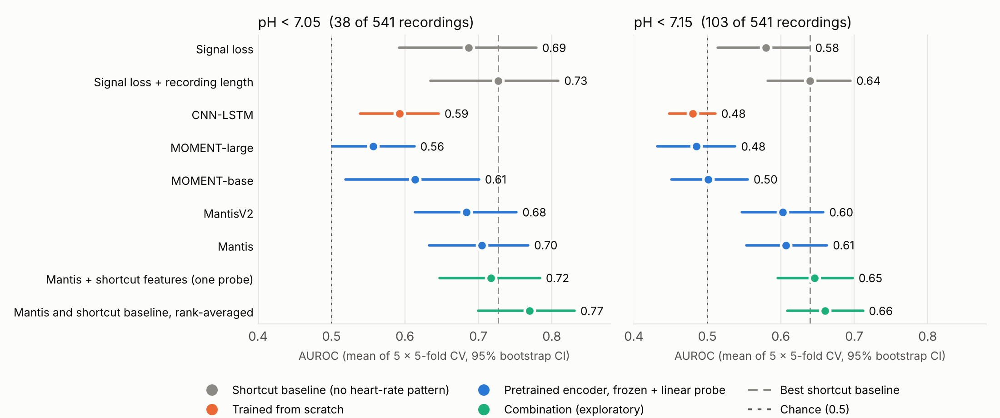
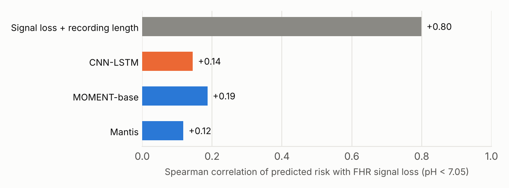

# Fetal acidemia from intrapartum CTG: a shortcut-aware benchmark

[](https://github.com/xiaoxurong/NE-code/actions/workflows/tests.yml)

Can a model read fetal distress from the heart-rate trace recorded during labor, or does it
only learn *how well the trace was recorded*? This repository predicts fetal acidemia
(umbilical artery pH at birth) from intrapartum cardiotocography (CTG). It compares a CNN-LSTM
trained from scratch with frozen pretrained time-series encoders (MOMENT, Mantis), and tests
every model against baselines that never look at the heart-rate pattern.

Everything runs end to end on the public
[CTU-UHB database](https://physionet.org/content/ctu-uhb-ctgdb/1.0.0/) (552 recordings; fetal
heart rate and uterine contractions at 4 Hz).



## Findings

- **Signal loss is a strong shortcut in CTU-UHB.** A logistic regression on how much of the
  trace is missing plus recording length, with no heart-rate pattern at all, reaches AUROC
  0.73 at pH < 7.05. Any model has to be judged against that, not against 0.5.
- **The CNN-LSTM trained from scratch learned delivery mode, not physiology.** It scores 0.59
  at pH < 7.05, below the shortcut baseline, and falls to chance (0.52) on vaginal deliveries
  only, where delivery mode cannot help. Cesarean deliveries are about six times as likely to be
  acidemic in this cohort (15 of 46, against 25 of 506 vaginal deliveries).
- **Frozen Mantis embeddings carry real heart-rate signal.** A linear probe reaches 0.705
  [0.633, 0.768] at pH < 7.05 (0.69 on new folds; 0.65 on vaginal deliveries only) and 0.61 at
  pH < 7.15. Unlike the baseline, its predictions barely follow signal loss (Spearman 0.12
  against 0.80; below). On its own it does not beat the shortcut baseline.
- **Mantis and the shortcut features are complementary, but the gain is small.** Averaging the
  two models' ranks (fixed equal weights, no labels used) gives 0.770 [0.700, 0.831], +0.043
  over the baseline. This combination was chosen after looking at those results, so it was then
  fixed in advance and rerun on five new fold assignments: there it gives 0.749 [0.675, 0.821],
  +0.027 [-0.016, +0.071]. The direction holds; the size shrinks and is not significant.
- **MOMENT's general-purpose embeddings are near chance** on this task (0.49-0.61).



## Results

Subject-level AUROC, 5-fold cross-validation repeated 5 times (identical folds for every
model), mean over repeats with a 95% stratified bootstrap interval. Full tables, including
AUPRC and every encoder variant, are in [`docs/tables/`](docs/tables).

| Model | pH < 7.05 (38 / 541) | vaginal only | pH < 7.15 (103 / 541) | vaginal only |
| --- | --- | --- | --- | --- |
| Shortcut: signal loss | 0.687 [0.592, 0.779] | 0.629 | 0.580 [0.514, 0.639] | 0.575 |
| Shortcut: signal loss + recording length | **0.727** [0.635, 0.809] | 0.703 | **0.640** [0.582, 0.695] | 0.637 |
| CNN-LSTM, trained from scratch | 0.593 [0.539, 0.646] | 0.524 | 0.480 [0.448, 0.511] | 0.465 |
| MOMENT-base, frozen + linear probe | 0.614 [0.519, 0.701] | 0.567 | 0.501 [0.451, 0.555] | 0.488 |
| MantisV2, frozen + linear probe | 0.684 [0.614, 0.752] | 0.641 | 0.603 [0.547, 0.658] | 0.600 |
| Mantis, frozen + linear probe | 0.705 [0.633, 0.768] | 0.653 | 0.607 [0.553, 0.663] | 0.597 |
| Mantis + shortcut features, one probe | 0.717 [0.647, 0.784] | 0.693 | 0.646 [0.596, 0.698] | 0.642 |
| Mantis and shortcut baseline, rank-averaged (exploratory) | **0.770** [0.700, 0.831] | 0.740 | **0.660** [0.609, 0.712] | 0.655 |

With 38 positives, AUROC intervals are about ±0.07-0.09 wide, so differences of a few hundredths
are not meaningful on their own. The paired bootstrap difference against the shortcut baseline
is in the tables (`dAUROC vs missingness_length`).

**Confirmation on new folds.** After choosing the combination, it was rerun unchanged on five new
fold assignments (`--fold_seed 1000`; baseline and probe refit, no settings changed):

| Model, `--fold_seed 1000` | pH < 7.05 | vaginal only | pH < 7.15 | vaginal only |
| --- | --- | --- | --- | --- |
| Shortcut: signal loss + recording length | 0.722 [0.633, 0.808] | 0.697 | 0.635 [0.576, 0.691] | 0.633 |
| Mantis, frozen + linear probe | 0.687 [0.615, 0.754] | 0.642 | 0.594 [0.540, 0.647] | 0.578 |
| Mantis and shortcut baseline, rank-averaged | 0.749 [0.675, 0.821] | 0.722 | 0.649 [0.596, 0.699] | 0.640 |
| Difference, rank-averaged vs shortcut | +0.027 [-0.016, +0.071] | +0.025 | +0.014 [-0.025, +0.051] | +0.007 |

Fold assignment alone moves these AUROCs by about 0.02, which is roughly how much the first
estimate of the combination's gain shrank.

## Approach

**Data.** Each recording becomes one 30-minute window ending at the start of the second stage
of labor, so every window sits at the same point in labor. Missing samples stay missing: they
are stored as a mask and passed to models as extra channels, never filled with zeros that look
like a heart rate. Scaling uses fixed physiological constants, so nothing is fit on test data.
Windows with less than 20% observed signal are dropped. A 50% filter would remove a quarter of
the positives but only 5% of the negatives, which would itself be a shortcut.

**Shortcut audit.** `prepare_ctu_uhb.py` compares positives and negatives on properties that
are not fetal physiology: signal loss, recording length and delivery type. `baselines.py`
turns them into logistic-regression baselines on the same folds as every model.

**Evaluation.** Subject-level splits (`StratifiedGroupKFold`), 5 folds × 5 repeats; metrics
pooled across folds within a repeat and averaged over repeats; stratified bootstrap intervals;
paired differences against the shortcut baseline; a vaginal-delivery subset that removes the
delivery-mode shortcut by design. Early stopping and model selection only ever see training
subjects.

**Pretrained encoders.** MOMENT and Mantis take 512 samples per channel. Downsampling a
30-minute window to 512 would erase short-term heart-rate variability, so each window is cut
into 14 chunks of about 2 minutes, each chunk is embedded at full resolution, and the chunk
embeddings are mean- and max-pooled. MOMENT receives the observed-mask; Mantis gets gaps
linearly interpolated. A standardized L2 logistic regression is fit per fold, with its
regularization chosen by an inner cross-validation on the training recordings only.

**Combination.** `combine.py` converts each run's out-of-fold predictions to percentile ranks
within a repeat and averages them with fixed weights. It never reads labels and fits nothing.

## Reproduce

```bash
git clone https://github.com/xiaoxurong/NE-code.git && cd NE-code
pip install -r requirements.txt

# 1. Download CTU-UHB (about 40 MB) and build the window files for both labels
python scripts/prepare_ctu_uhb.py --wfdb_dir data/ctu-uhb --download --ph_threshold 7.05
python scripts/prepare_ctu_uhb.py --wfdb_dir data/ctu-uhb --ph_threshold 7.15

D=ctu_uhb_stage1_end_w30m_n1_v0.2_ph7.05
W=${D%_ph*}

# 2. Shortcut baselines (CPU, seconds)
python scripts/baselines.py --data dataset/$D.npz --n_repeats 5 --out_dir results/$D/baselines

# 3. Frozen Mantis embeddings (GPU recommended) and the linear probe (CPU, minutes)
python scripts/extract_embeddings.py --data dataset/$D.npz --model mantis --out embeddings/${W}__mantis.npz
python scripts/probe.py --data dataset/$D.npz --embeddings embeddings/${W}__mantis.npz \
    --pool meanmax --n_repeats 5 --out_dir results/$D/probe_mantis_meanmax

# 4. CNN-LSTM trained from scratch (GPU)
python run.py --config configs/ctu_uhb_cnn_lstm.yaml --data_path $D.npz --results_dir results/$D/cnn_lstm_wbce

# 5. Combination, evaluation and figures
python scripts/combine.py --runs results/$D/probe_mantis_meanmax results/$D/baselines/missingness_length \
    --out_dir results/$D/combo_mantis+shortcut
python scripts/evaluate.py --data dataset/$D.npz \
    --runs mantis=results/$D/probe_mantis_meanmax combo=results/$D/combo_mantis+shortcut \
           cnn_lstm=results/$D/cnn_lstm_wbce missingness_length=results/$D/baselines/missingness_length \
    --reference missingness_length --subset all vaginal --out results/$D/table.csv
```

Every script that splits the data takes `--fold_seed` (default 42); the confirmation table above is steps 2, 3 and 5
rerun with `--fold_seed 1000` into `results/<window file>_seed1000/`.

Embeddings do not depend on the label, so one extraction serves both thresholds. For MOMENT,
install `momentfm` with `--no-deps`; see `requirements.txt` for the pins that work with
PyTorch < 2.6.

### On an HTCondor cluster (CHTC)

`chtc/` runs every repeat and encoder as its own job and collects the results:

```bash
mkdir -p chtc/logs
condor_submit chtc/cnn_lstm.sub          # 10 GPU jobs: 2 thresholds x 5 repeats
condor_submit chtc/extract.sub           # 6 GPU jobs: one per encoder
bash chtc/collect_and_evaluate.sh        # unpacks embeddings/
condor_submit chtc/probe.sub             # 24 CPU jobs: threshold x encoder x shortcuts
bash chtc/collect_and_evaluate.sh        # baselines, combination, tables, figures
```

The job wrappers install only missing packages into the job directory, fail fast if an import
is missing, always return a tarball (with a `FAILED` marker on error) and put failed jobs on
hold with a readable reason. GPU jobs are restricted to compute capability 7.0-9.x because the
PyTorch 2.4 container has no kernels for Blackwell GPUs.

## Reproducibility notes

- **Folds depend on the scikit-learn version.** scikit-learn 1.8 changed how
  `StratifiedGroupKFold(shuffle=True)` assigns groups, so the same seed gives different folds
  before and after 1.8. All results here use >= 1.8; `utils/splits.py` refuses older versions,
  a test pins the expected fold assignment, and `evaluate.py` warns when two runs were made on
  different folds.
- **Pretrained-encoder dependencies.** transformers 5.x silently disables PyTorch < 2.6, which
  breaks MOMENT; the extraction job pins versions that work together.
- Seeds are fixed for Python, NumPy and PyTorch, and every script that splits the data calls
  the same function.

## Tests

```bash
python -m pytest tests -q
```

The tests run on synthetic recordings in the CTU-UHB file format. They cover header
parsing, missing-value handling, window placement relative to stage II and birth, resumable
downloads, subject-level splits without leakage, the pinned fold assignment, the baselines,
evaluation and combination, embedding extraction with stub and randomly initialized encoders,
and a regression test that the CNN-LSTM learns a planted signal instead of collapsing to a
constant. Tests needing PyTorch, `momentfm` or `mantis-tsfm` are skipped when those are absent.

## Repository layout

```
scripts/prepare_ctu_uhb.py     download CTU-UHB, build windows, audit confounds
scripts/baselines.py           shortcut baselines on the shared folds
scripts/extract_embeddings.py  frozen MOMENT / Mantis embeddings, 14 full-resolution chunks per window
scripts/probe.py               linear probe with inner-CV regularization
scripts/combine.py             label-free rank averaging of runs
scripts/evaluate.py            subject-level AUROC/AUPRC, bootstrap CIs, paired differences
scripts/make_figures.py        README figures and docs/tables/
run.py                         cross-validated training of the deep models (exp/, model/)
configs/                       CNN-LSTM configurations
chtc/                          HTCondor submit files, job wrappers, result collection
data_provider/  utils/         CTU-UHB loader, datasets, splits, metrics
tests/                         pytest suite
```

## Limitations and next steps

- One public cohort of 541 usable recordings and 38 positives at pH < 7.05; intervals are wide,
  and nothing here has been validated externally.
- The combination's gain over the shortcut baseline is consistent but small (+0.03 on new
  folds) and not significant with 38 positives. An external cohort is the real test.
- The CNN-LSTM reads the last of about 1,800 LSTM steps and was not tuned; more downsampling,
  pooling over time and a higher learning rate are the obvious fixes.
- Mantis sees about 2 minutes at a time. Fine-tuning it with attention across chunks is the most
  promising way past a frozen probe.
- Umbilical pH is a proxy outcome. This project began as neonatal encephalopathy prediction on a
  private clinical cohort, which cannot be shared; this release uses public data only.

## References

- Chudáček V, Spilka J, Burša M, et al. Open access intrapartum CTG database.
  *BMC Pregnancy and Childbirth* 14:16 (2014). Data: Open Data Commons Attribution License v1.0.
- Goldberger AL, et al. PhysioBank, PhysioToolkit, and PhysioNet. *Circulation* 101(23):e215-e220 (2000).
- Goswami M, et al. MOMENT: A family of open time-series foundation models. *ICML* (2024).
- Feofanov V, et al. Mantis: Lightweight calibrated foundation model for user-friendly time
  series classification (2025). <https://github.com/vfeofanov/mantis>

## License

MIT (code). CTU-UHB data are not redistributed here; `prepare_ctu_uhb.py` downloads them from
PhysioNet.
